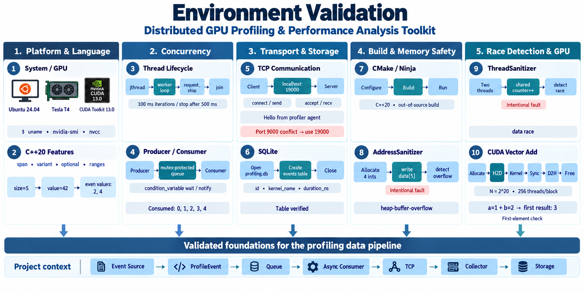
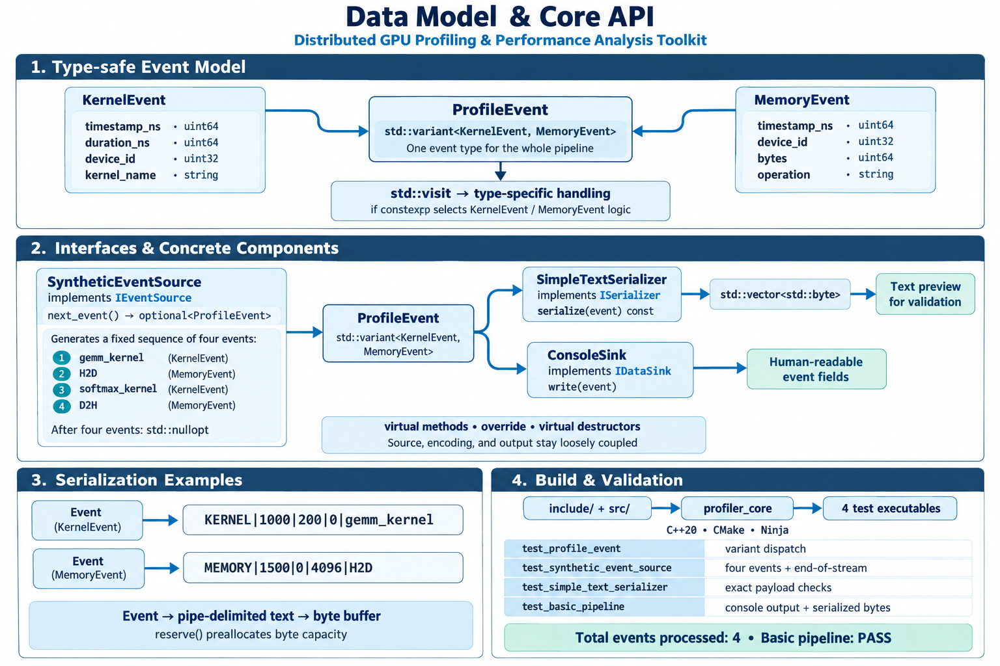
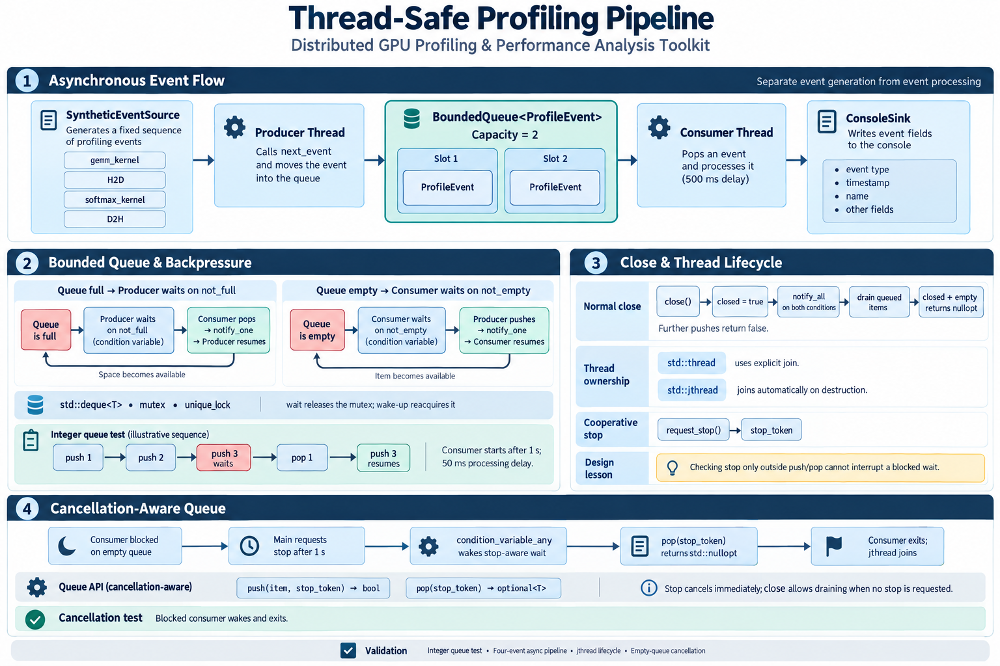
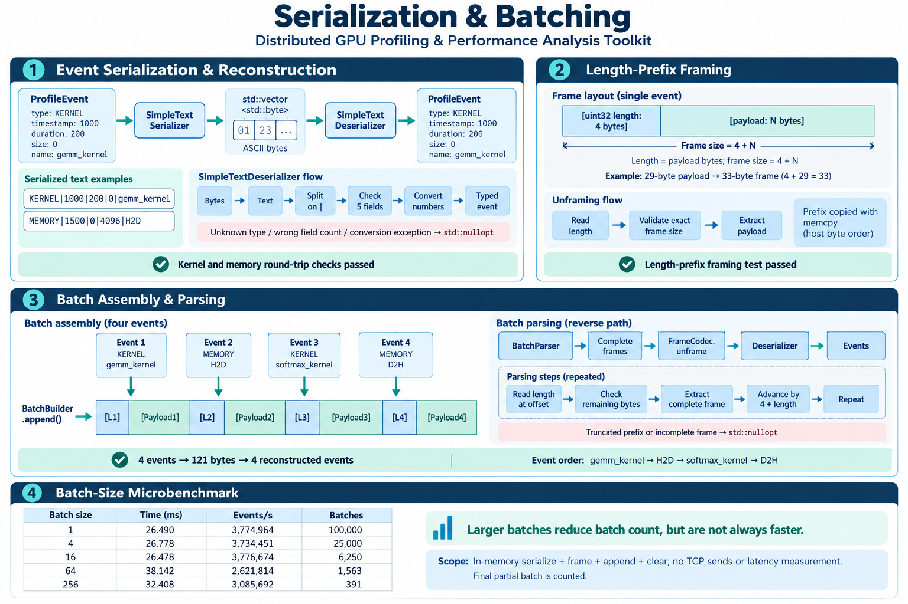
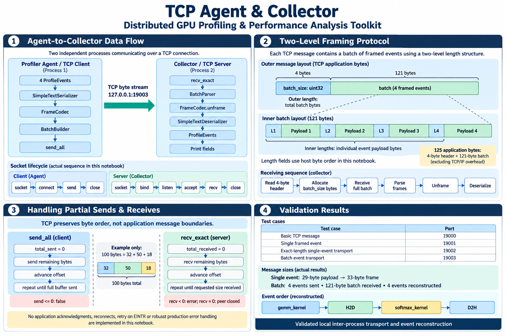
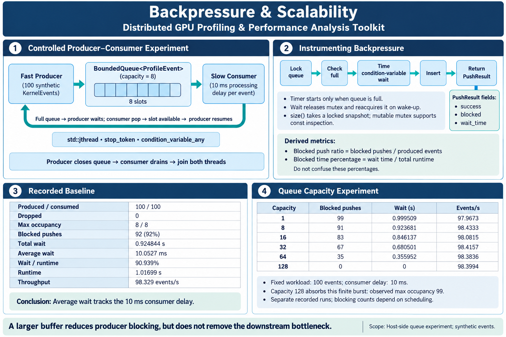
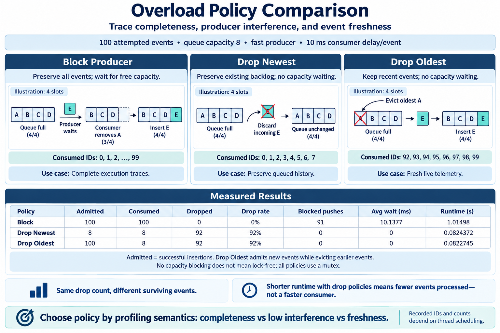
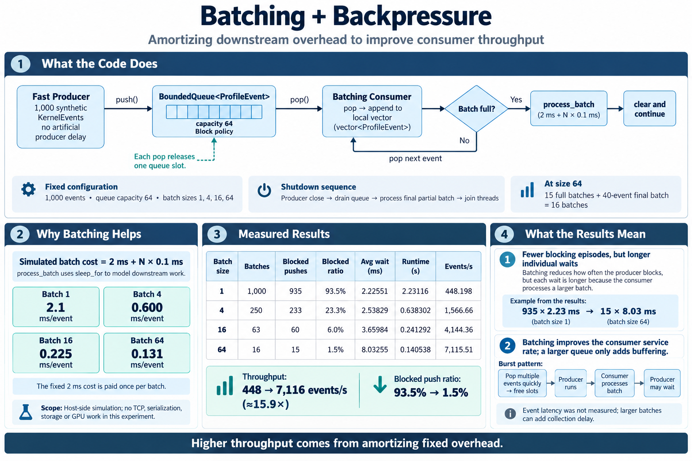
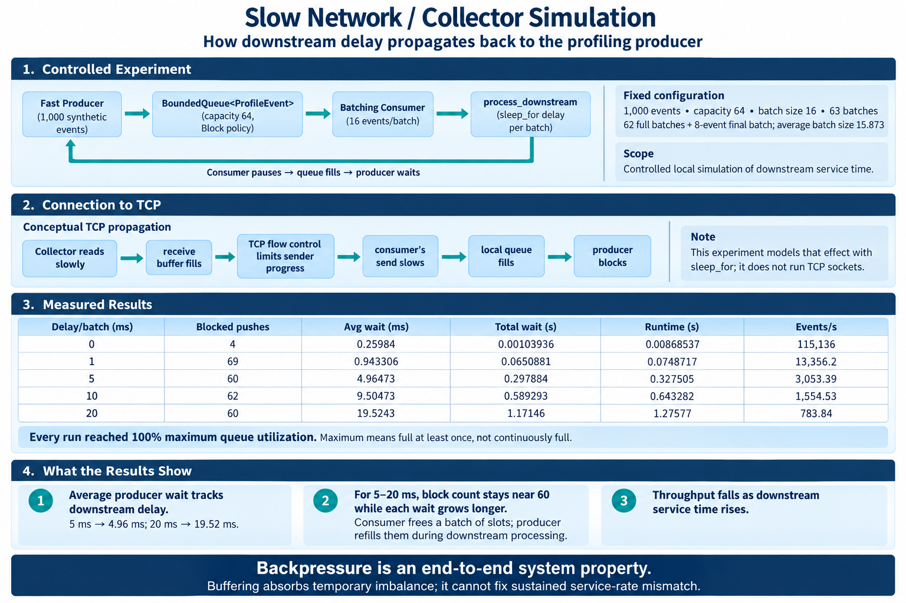

# Distributed GPU Profiling & Performance Analysis Toolkit

A C++20 distributed profiling data pipeline that models the core infrastructure for collecting, buffering, encoding, batching, transporting, and reconstructing high-rate GPU profiling events. The project connects systems programming with quantitative performance analysis, focusing on the trade-offs among event completeness, profiling overhead, memory usage, throughput, and latency.

- Source code: [github](https://github.com/licheng2018/Modern-GPU-Performance-Profiling-Runtime-Toolkit)
- Core components: Event model, concurrent pipeline, serialization, framing, batching, TCP agent/collector, and backpressure analysis.
- Project scope: Synthetic kernel and memory events, extensible GPU source interfaces, collector storage design, and performance analysis.

## Contents

- [Project Goal](#project-goal)
- [System Architecture](#system-architecture)
- [Project Modules](#project-modules)
- [Event Model and Core API](#event-model-and-core-api)
- [Concurrent Pipeline](#concurrent-pipeline)
- [Serialization, Framing, and Batching](#serialization-framing-and-batching)
- [TCP Agent and Collector](#tcp-agent-and-collector)
- [Backpressure Experiment](#backpressure-experiment)
- [Scalability and Overload Policies](#scalability-and-overload-policies)
- [Storage, GPU Integration, and Final Benchmark](#storage-gpu-integration-and-final-benchmark)
- [Engineering Takeaways](#engineering-takeaways)

## Project Goal

Build and study the data path behind GPU profiling infrastructure: events must move safely from an application-side source to an independent collector without unbounded buffering or assumptions about network message boundaries.

The central question is how to collect, transport, reconstruct, and analyze a high-rate event stream while controlling the profiler's own impact on the application. The toolkit is an infrastructure project with synthetic-source validation, rather than a replacement for a complete GPU profiler such as Nsight or rocprof.



















## System Architecture

```text
Synthetic Event Source                     GPU / ROCm / CUDA source interface
          |                                             |
          +---------------- IEventSource ---------------+
                                  |
                             ProfileEvent
                                  |
                            Producer thread
                                  |
                       BoundedQueue<ProfileEvent>
                         bounded buffering / backpressure
                                  |
                            Consumer thread
                                  |
                   Serializer -> FrameCodec -> BatchBuilder
                                  |
                              TCP Agent
                                  |
                  TCP stream: [batch_size][batch_bytes]
                                  |
                            TCP Collector
                                  |
                   BatchParser -> Unframe -> Deserialize
                                  |
                             ProfileEvent
                                  |
                       SQLite / Analysis design
```

The source abstraction separates event acquisition from the downstream pipeline. A GPU event backend can feed the same queue, serializer, batching logic, and transport components.

## Project Modules

| Module | Focus |
|---|---|
| 01 — Environment validation | C++20, Linux, sockets, SQLite, and CUDA environment checks |
| 02 — Data model and core API | Unified events, interfaces, and synthetic source |
| 03 — Thread-safe pipeline | Bounded queue, threads, cooperative cancellation |
| 04 — Serialization and batching | Event encoding, length-prefixed frames, batch construction and parsing |
| 05 — TCP agent and collector | Inter-process transport and event reconstruction |
| 06 — Backpressure and scalability | Queue pressure, producer blocking, capacity and overload policy analysis |
| 07 — SQLite storage | Collector persistence design and profiling queries |
| 08 — GPU profiling integration | ROCm/CUDA event backend design through the source interface |
| 09 — Final benchmark | End-to-end throughput, latency, overhead, and bottleneck analysis methodology |

## Event Model and Core API

A unified, type-safe event model represents kernel execution and memory activity:

```cpp
using ProfileEvent = std::variant<KernelEvent, MemoryEvent>;
```

Kernel events carry a timestamp, duration, device ID, and kernel name. Memory events carry a timestamp, device ID, byte count, and operation. `std::visit` dispatches by event type without requiring separate transport pipelines.

Interfaces such as `IEventSource`, `ISerializer`, `IDeserializer`, and `IDataSink` keep event acquisition, encoding, reconstruction, and output responsibilities separate. This design practices C++ API abstraction, RAII, const correctness, and extensibility.

## Concurrent Pipeline

The producer and consumer communicate through `BoundedQueue<ProfileEvent>`. Its fixed capacity bounds the number of queued events and exposes overload as an explicit system behavior.

- `std::mutex` and `std::unique_lock` protect shared queue state.
- `condition_variable_any` lets producers wait when the queue is full and consumers wait when it is empty.
- `std::jthread` and `std::stop_token` support cooperative cancellation.
- Thread-safe `size()` and `capacity()` expose queue occupancy for measurement.

When a producer waits on a full queue, the wait releases the mutex. A consumer can remove an event and notify the waiting producer, which reacquires the mutex before continuing. The blocking policy preserves events in the measured workload while transferring downstream pressure upstream.

## Serialization, Framing, and Batching

The serializer converts typed events into byte payloads. An illustrative kernel payload is:

```text
KERNEL|1000|200|0|gemm_kernel
```

The payload is represented as `std::vector<std::byte>`. A deserializer reconstructs `ProfileEvent`, and a round-trip check validates event-to-bytes-to-event reconstruction.

`FrameCodec` wraps each payload with a `uint32_t` length prefix. `BatchBuilder` joins multiple event frames, and `BatchParser` uses their lengths to recover individual frames:

```text
Outer network message:
[batch_size][batch_bytes]

Inside batch_bytes:
[event_size][event_payload][event_size][event_payload] ...
```

The outer prefix identifies the complete batch size on the network. Inner prefixes identify event boundaries within that batch. Batching groups events into fewer downstream send operations; its throughput and latency effects are key benchmark dimensions.

## TCP Agent and Collector

The agent serializes and batches events before sending them to a separate collector process. The collector receives a batch, parses its frames, removes framing, and deserializes the payloads back into typed events.

The implementation uses POSIX socket operations including `socket`, `connect`, `bind`, `listen`, `accept`, `send`, `recv`, and `close`.

TCP is an ordered byte stream: one `send()` does not imply one matching `recv()`. The transport handles partial operations explicitly:

- `send_all()` advances through the remaining bytes until the buffer is sent.
- `recv_exact()` accumulates bytes until the expected length is received.
- The collector reads the outer length before reading the batch body and reconstructing its events.

These components establish the inter-process data path and provide the foundation for studying distributed scaling and downstream bottlenecks.

## Backpressure Experiment

The initial overload experiment used **100 events**, a **queue capacity of 8**, and an artificial **10 ms consumer delay per event**. The following measurements are reported in the project overview:

| Metric | Reported result |
|---|---:|
| Produced / consumed events | 100 / 100 |
| Maximum queue occupancy | 8 events |
| Maximum queue utilization | 100% |
| Producer block count | 92 |
| Blocked push ratio | 92% |
| Total producer blocked time | Approximately 0.925 s |
| Average block time | Approximately 10.05 ms |
| Runtime | Approximately 1.017 s |
| Throughput | Approximately 98 events/s |

The average producer wait closely follows the imposed consumer delay: a consumer releases one queue slot about every 10 ms, allowing the producer to resume. The queue stays within its configured capacity, and all 100 events are consumed in this run.

The observed 92 blocked pushes are consistent with a fast producer exhausting the initial eight slots. Exact blocking counts depend on thread scheduling; this result characterizes the recorded workload rather than a universal queue invariant.

This is a synthetic producer-consumer measurement, not a real GPU profiling throughput measurement or an end-to-end TCP/storage benchmark.

## Scalability and Overload Policies

The queue-capacity experiment design keeps 100 events and the 10 ms consumer delay fixed while varying queue capacity across `1`, `8`, `16`, `32`, `64`, and `128`. The measurement dimensions are blocking count, blocked time, queue occupancy, throughput, and runtime.

Larger buffers absorb more of a finite burst and reduce producer blocking, while steady-state throughput remains limited by the slow consumer. A larger queue postpones backpressure; it does not eliminate the downstream bottleneck.

The overload policy design compares how to make the completeness/overhead trade-off explicit:

| Policy | Behavior when full | Main trade-off |
|---|---|---|
| Block producer | Wait for a free slot | Retains events but can stall the instrumented application |
| Drop newest | Discard the arriving event | Avoids queue waiting while losing new events |
| Drop oldest | Evict the oldest queued event | Favors recent telemetry while losing historical events |

The batching and downstream-pressure experiment design compares batch sizes `1`, `4`, `16`, and `64`, and simulates slow networks or collectors to study how pressure propagates upstream. The analysis considers throughput, event latency, blocking, and loss rather than assume one configuration is universally best.

## Storage, GPU Integration, and Final Benchmark

The SQLite storage design maps reconstructed events to queryable profiling data. Event records include timestamps, event types, device IDs, kernel names, durations, byte counts, and memory operations. Queries cover slowest kernels, total kernel time, memory-transfer volume, event counts, and activity grouped by device.

The GPU integration design connects ROCm or CUDA event callbacks and traces to `ProfileEvent` through `IEventSource`. The same queue, serializer, batching logic, TCP transport, and collector can be reused across source backends. Integration evaluation focuses on event semantics and the profiler's impact on actual GPU workloads.

The final benchmark methodology covers the complete source-to-collector-to-storage path while varying event rate, queue capacity, batch size, consumer speed, network delay, and overload policy. Metrics include throughput, latency, producer blocked time, drop rate, queue occupancy, and memory usage.

| Dimension | Configurations / Measurements |
|---|---|
| Event source | Synthetic workload and GPU backend interface |
| Queue capacity | `1`, `8`, `16`, `32`, `64`, `128` |
| Batch size | `1`, `4`, `16`, `64` |
| Overload policy | Block producer, drop newest, drop oldest |
| Downstream pressure | Consumer delay, network delay, collector processing cost |
| Performance | Throughput, event latency, blocked time, drop rate, queue occupancy, memory usage |

The analysis connects configuration choices to profiling objectives: complete traces, low application interference, high throughput, or low latency.

## Engineering Takeaways

- A bounded concurrent queue turns overload into observable blocking or loss instead of unbounded event accumulation.
- Type-safe events and backend interfaces separate acquisition from transport and reconstruction.
- TCP transport requires explicit framing and handling of partial sends and receives.
- Queue capacity, batching, and overload policy affect different parts of the buffering, throughput, and latency trade-off.
- A profiler must measure its own interference: complete event capture can be costly if it blocks the application being observed.

**Technologies practiced:** C++20, `std::variant`, `std::visit`, templates, RAII, const correctness, `std::byte`, mutexes, condition variables, `std::jthread`, `std::stop_token`, `std::chrono`, Linux, and POSIX TCP sockets. The broader system design also covers SQLite persistence and ROCm/CUDA profiling integration.

[Back to Home](../index.md)
