# MLIR-Based Triton Compiler Optimization Framework

This project connects GPU compiler theory with real Triton GEMM compilation, IR inspection, optimization prototypes, and correctness validation. I traced a tiled matrix multiplication kernel from Triton through MLIR-based representations to LLVM IR and NVIDIA PTX, then investigated how compiler transformations simplify redundant computation and memory addressing.

[GitHub Repository](https://github.com/licheng2018/MLIR-Based-Triton-Compiler-Optimization-Framework)

## Project Goal

Understand how GPU computations are lowered across compiler stages, identify optimization opportunities in generated IR, and validate transformations with structural checks and executable correctness experiments.

## Compiler Pipeline

```text
Triton GEMM -> TTIR -> TTGIR -> LLVM IR -> PTX -> GPU Execution
               |                 |
          CSE / LICM        CFG / PHI / LSR
```

The GEMM kernel uses FP16 inputs, FP32 accumulation, a 32 × 64 × 32 tile, four warps per CTA, masked memory accesses, and a K-dimension reduction loop. GPU experiments ran on an NVIDIA Tesla T4 in Google Colab; isolated LLVM transformation experiments targeted x86-64.

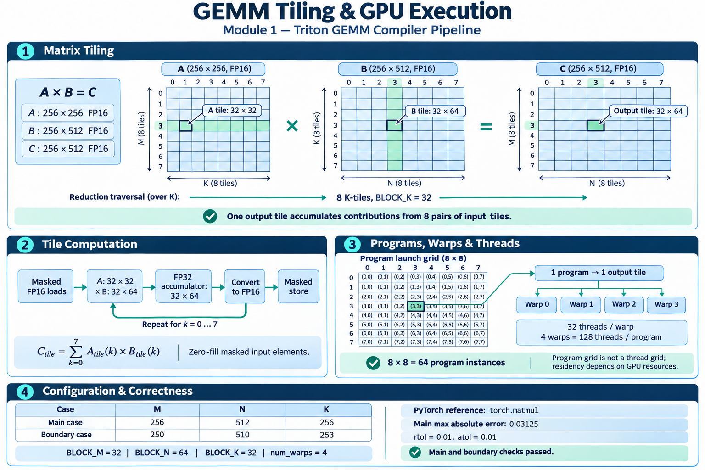

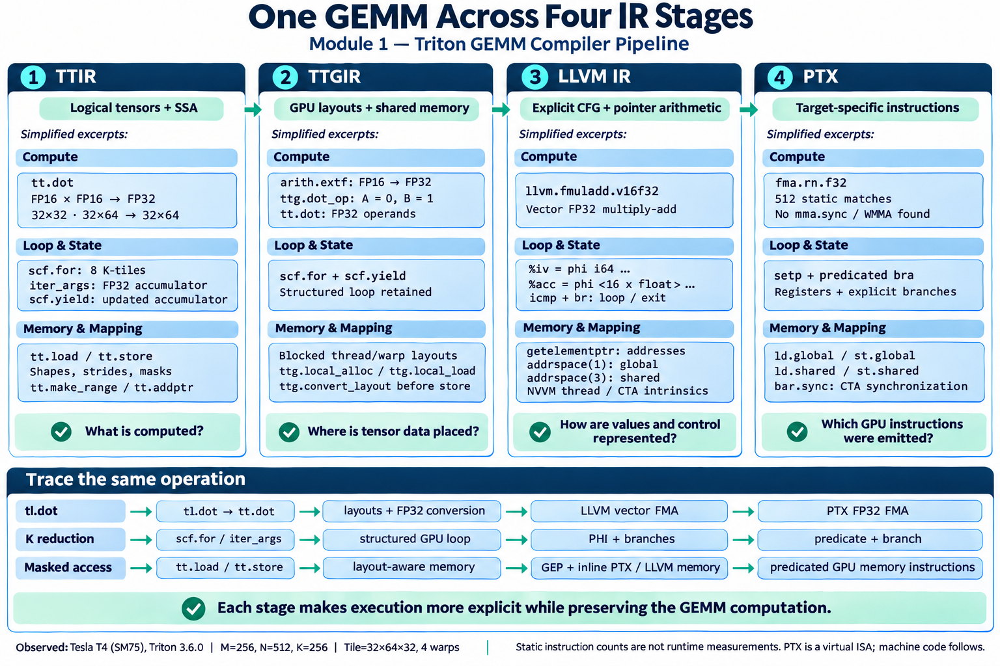

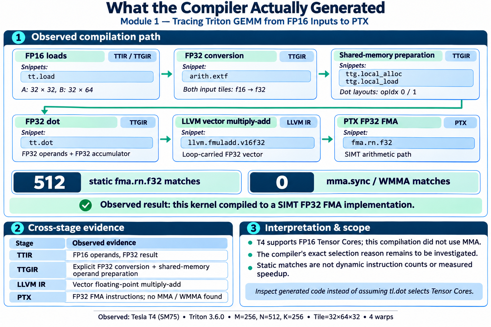

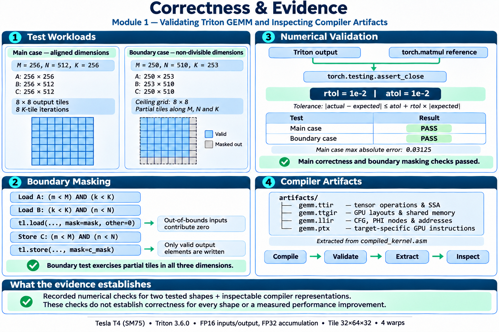

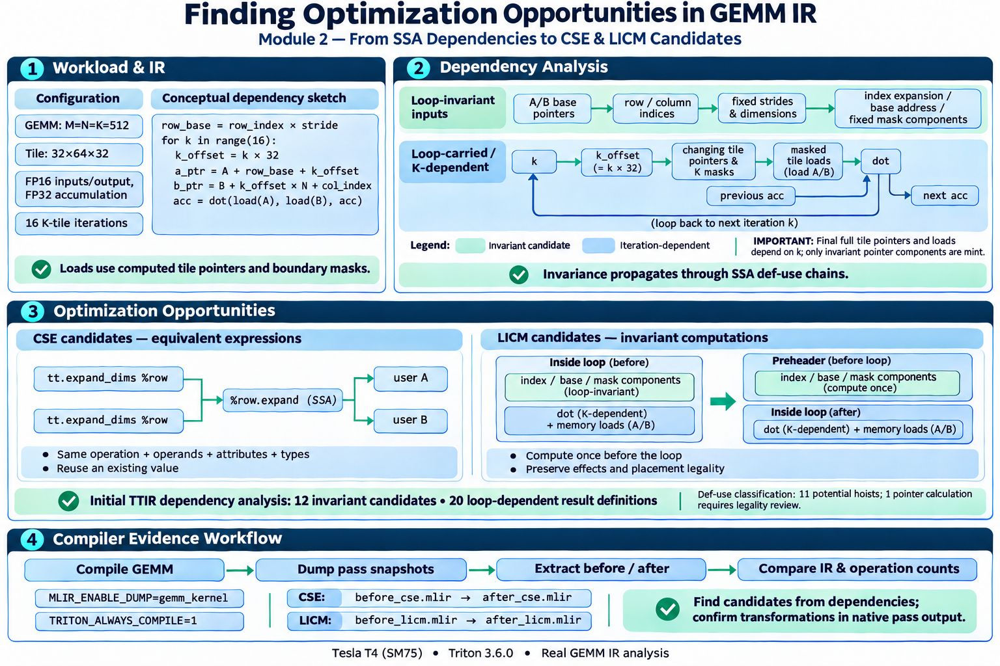

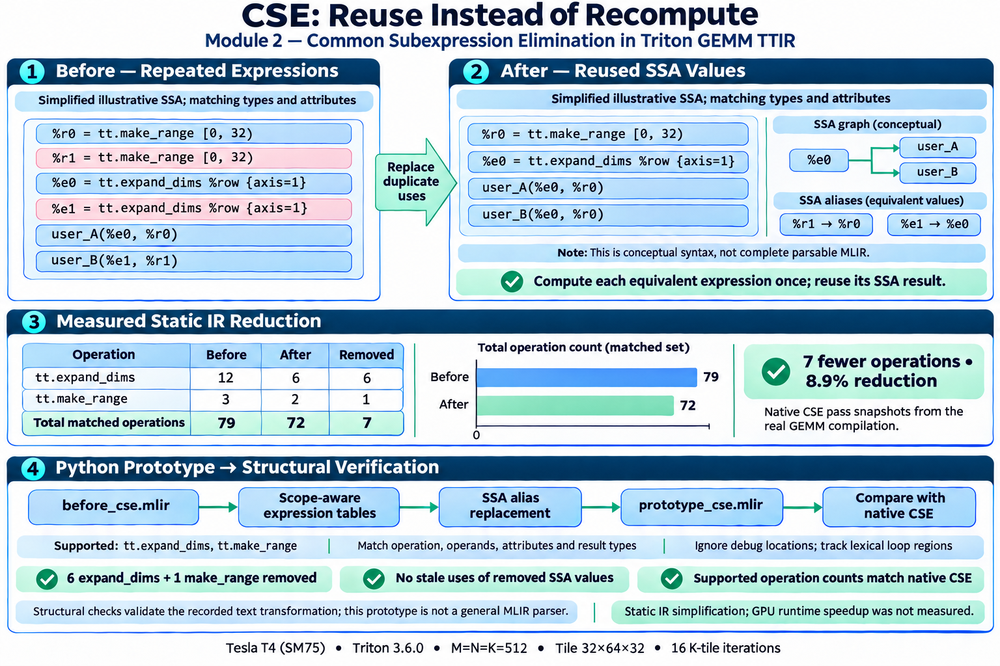

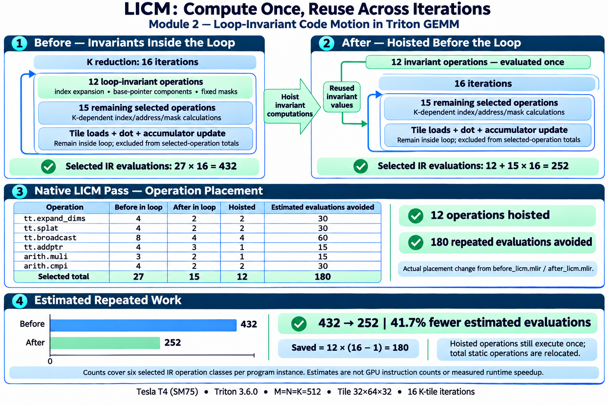

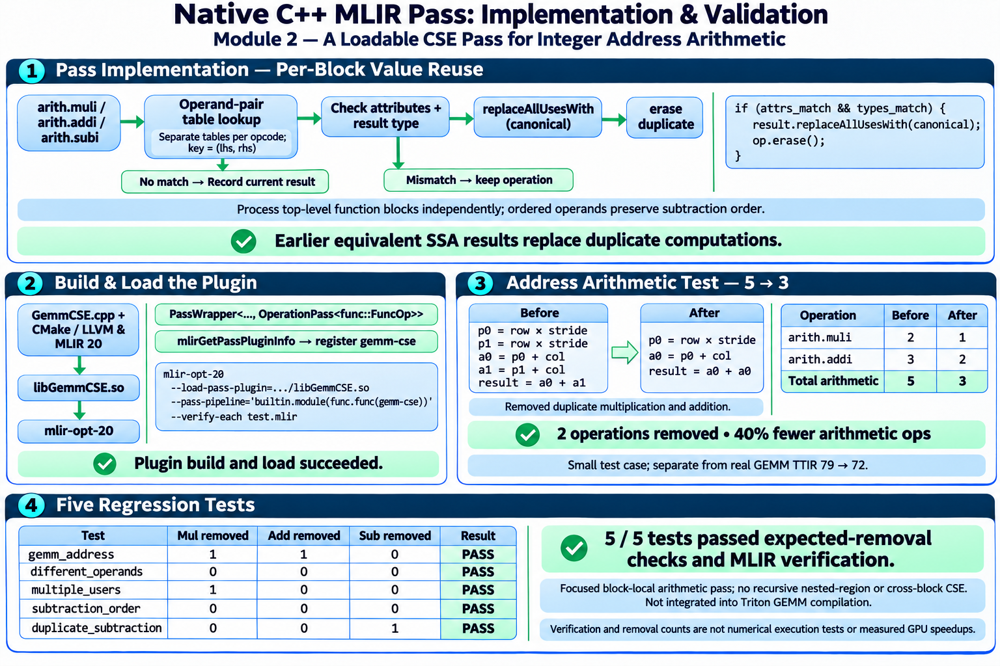

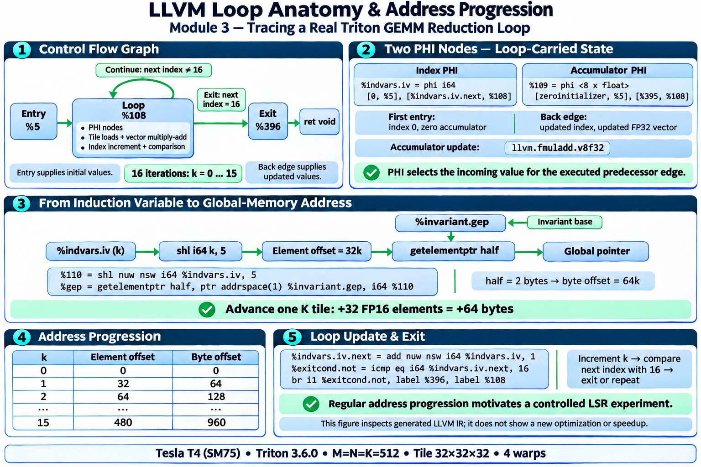

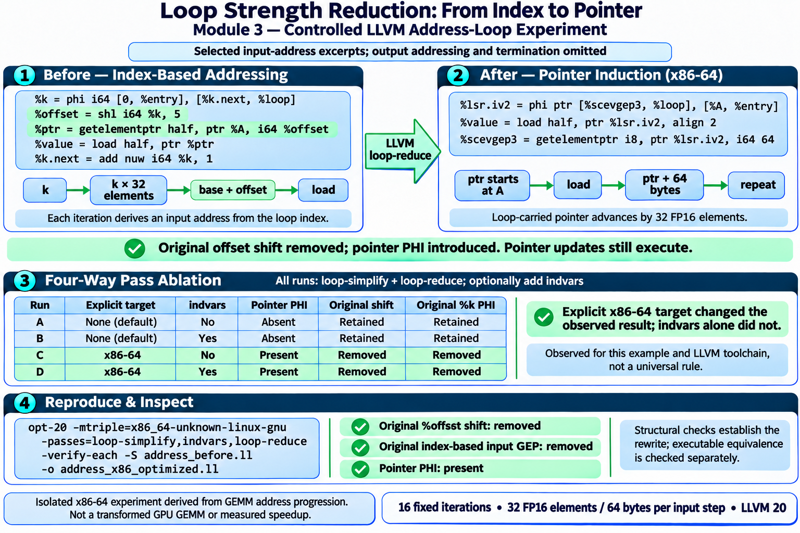

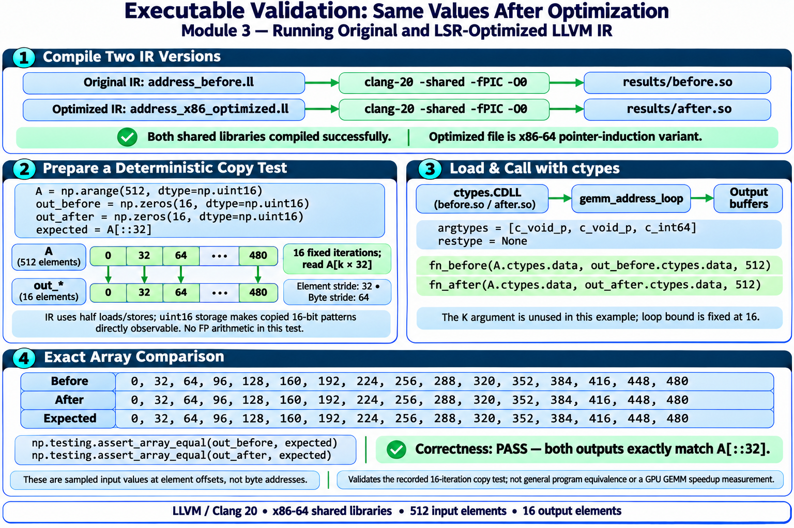

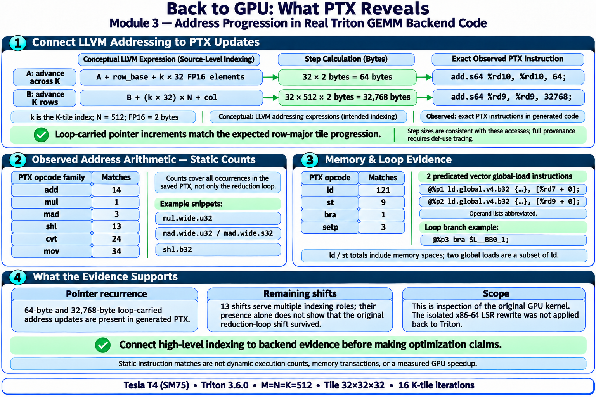

## Module 1 — Triton GEMM Compiler Pipeline Exploration

[Read the original experiment notebook](https://github.com/licheng2018/MLIR-Based-Triton-Compiler-Optimization-Framework/blob/main/triton_gemm_compiler_pipeline.ipynb)

This module follows one working GEMM kernel through implementation, numerical validation, compiler artifact extraction, GPU layout analysis, and LLVM/PTX inspection. The results below come from the notebook's saved execution outputs.

### 1. Environment and Workload

| Component | Recorded configuration |
|---|---|
| Platform | Google Colab, Linux x86-64 |
| GPU | NVIDIA Tesla T4, compute capability 7.5, 40 SMs, 14.56 GiB reported memory |
| Software | Python 3.13.16, PyTorch 2.11.0+cu130, CUDA 13.0, Triton 3.6.0 |
| CUDA tools | `ptxas` and `nvcc` available |
| Standalone compiler tools | `clang`, `llvm-config`, and `mlir-opt` absent from PATH during initial inspection |
| Matrix dimensions | M = 256, N = 512, K = 256 |
| Tile dimensions | BLOCK_M = 32, BLOCK_N = 64, BLOCK_K = 32 |
| Execution | 4 warps per CTA; launch grid (8, 8) |
| Precision | FP16 input/output, FP32 accumulation |

The initial Triton compilation and IR extraction ran without installing standalone LLVM/MLIR utilities. Each program computes one 32 × 64 output tile, reducing over eight 32-element K tiles.

### 2. Kernel Implementation and Correctness

The kernel uses `tl.program_id` to identify output tiles and `tl.arange` to construct row, column, and reduction indices. Matrix strides translate those indices into pointers. Masked loads substitute zero outside valid input bounds, and a masked store writes only valid output elements.

The central computation is summarized below; pointer construction and launch arguments are omitted for readability.

```python
pid_m = tl.program_id(axis=0)
pid_n = tl.program_id(axis=1)
offsets_m = pid_m * BLOCK_M + tl.arange(0, BLOCK_M)
offsets_n = pid_n * BLOCK_N + tl.arange(0, BLOCK_N)
offsets_k = tl.arange(0, BLOCK_K)
accumulator = tl.full((BLOCK_M, BLOCK_N), 0, dtype=tl.float32)

for k_tile in range(tl.cdiv(K, BLOCK_K)):
    k_offsets = k_tile * BLOCK_K + offsets_k
    # Build strided A/B pointers and boundary masks.
    a = tl.load(a_ptrs, mask=a_mask, other=0)
    b = tl.load(b_ptrs, mask=b_mask, other=0)
    accumulator = tl.dot(a, b, accumulator)

tl.store(c_ptrs, accumulator.to(tl.float16), mask=c_mask)
```

| Validation | Notebook result |
|---|---|
| Reference | `torch.matmul(A, B)` |
| Comparison | `torch.testing.assert_close`, rtol = 1e-2, atol = 1e-2 |
| Main case: M=256, N=512, K=256 | Passed; maximum absolute error 0.03125 |
| Boundary case: M=250, N=510, K=253 | Passed boundary masking validation |

The main-case error passed the combined relative and absolute tolerance check. The boundary case exercises partial tiles along all three dimensions. These are correctness checks, rather than performance benchmarks.

### 3. Compiler Artifact Extraction and TTIR

The returned `CompiledKernel` exposes `source`, `ttir`, `ttgir`, `llir`, `ptx`, and `cubin` artifacts. The notebook saves the four textual representations for inspection:

```python
from pathlib import Path

artifacts = Path("artifacts")
artifacts.mkdir(exist_ok=True)
for stage in ("ttir", "ttgir", "llir", "ptx"):
    (artifacts / f"gemm.{stage}").write_text(compiled_kernel.asm[stage])
```

This produces `gemm.ttir`, `gemm.ttgir`, `gemm.llir`, and `gemm.ptx`. PTX is a virtual instruction representation; the later CUBIN contains GPU machine code. The module inspects PTX rather than a SASS disassembly.

| Stage | What becomes visible |
|---|---|
| TTIR | Logical tensor shapes, SSA dependencies, indexing, masked loads/stores, dot computation, structured reduction loop |
| TTGIR | GPU layouts, warp/thread organization, shared-memory preparation, dot operand layouts, output layout conversion |
| LLVM IR | Explicit control flow, PHI nodes, pointer arithmetic, vector arithmetic, address spaces, NVVM intrinsics |
| PTX | Target-specific arithmetic, vectorized global accesses, shared-memory accesses, predicates, synchronization |

In the saved TTIR, the notebook identifies two `tt.load` operations, one `tt.store`, one `tt.dot`, and one `scf.for`. The dot consumes 32 × 32 and 32 × 64 FP16 tiles and returns a 32 × 64 FP32 accumulator. `iter_args` carries that accumulator across the eight loop iterations; `scf.yield` returns its updated value.

These are static operations in the IR. A load operation inside the loop executes repeatedly and represents a tensor access rather than a single scalar transaction.

### 4. TTGIR: Layouts and Dot Operand Preparation

The TTGIR module records target `cuda:75`, four warps, 32 threads per warp, and one CTA per program instance. Three blocked layouts describe how logical tensor elements are distributed across execution resources.

| Layout | sizePerThread | threadsPerWarp | warpsPerCTA | order |
|---|---|---|---|---|
| `#blocked` | [1, 8] | [4, 8] | [4, 1] | [1, 0] |
| `#blocked1` | [1, 8] | [8, 4] | [4, 1] | [1, 0] |
| `#blocked2` | [4, 4] | [2, 16] | [4, 1] | [1, 0] |

`sizePerThread` describes the layout's per-thread element arrangement, `threadsPerWarp` distributes a warp across tensor dimensions, and `warpsPerCTA` organizes the four warps. These attributes expose execution placement that is absent from the logical TTIR tensor types.

The saved lowering sequence for each dot operand is:

```text
FP16 tile loaded with a blocked layout
-> arith.extf: convert FP16 to FP32
-> ttg.local_alloc: prepare shared-memory storage
-> ttg.local_load: load with a dedicated dot operand layout
-> tt.dot: FP32 operands and FP32 accumulator
-> scf.yield: carry the accumulator to the next iteration
```

A uses `#ttg.dot_op` with `opIdx = 0`; B uses `opIdx = 1`, both with parent `#blocked2`. The final accumulator is truncated to FP16 with `arith.truncf`.

There is one explicit `ttg.convert_layout` before the output store:

```mlir
%0 = ttg.convert_layout %c
    : tensor<32x64xf16, #blocked2>
   -> tensor<32x64xf16, #blocked>
```

The shape and element type stay the same while thread ownership changes from the computation layout to the store layout. Its exact exchange mechanism and runtime cost require lower-level inspection and profiling.

### 5. PTX Finding: SIMT FP32 FMA

The generated PTX implements this kernel's matrix arithmetic using FP32 FMA. The saved search finds no `mma.sync` or WMMA instructions, despite the T4's FP16 Tensor Core support.

| PTX instruction or pattern | Static matches |
|---|---:|
| `fma.rn.f32` | 512 |
| `mma.sync` | 0 |
| `wmma` | 0 |
| `bar.sync` | 6 |

This agrees with TTGIR's explicit FP16-to-FP32 conversions and LLVM's vector multiply-add operations. The cause of the compiler's choice remains open; the notebook does not establish that the hardware lacks support or that this is the best-performing implementation.

### 6. LLVM: Control Flow, SSA, and PHI Nodes

The LLVM module contains one `gemm_kernel` function using the `ptx_kernel` calling convention. Its three basic blocks are entry, loop, and exit, with a self-loop back edge:

```text
Entry %5 -> Loop %116 -> Exit %420 -> ret void
                ^  |
                |__| continue
```

Two PHI nodes preserve the loop's state:

```llvm
%indvars.iv = phi i64 [ 0, %5 ], [ %indvars.iv.next, %116 ]
%117 = phi <16 x float> [ zeroinitializer, %5 ], [ %419, %116 ]
```

On initial entry, they select zero for the index and accumulator. On the back edge, they select the incremented index and updated FP32 vector. The `<16 x float>` value represents part of the distributed logical accumulator. Its update includes `llvm.fmuladd.v16f32`, with `insertelement` and `shufflevector` preparing vector operands.

| Structured TTGIR construct | LLVM representation |
|---|---|
| `scf.for` | Basic blocks and branches |
| Loop induction variable | Index PHI node, increment, and comparison |
| `iter_args` | Accumulator PHI node |
| `scf.yield` | Updated value arriving on the back edge |
| Loop termination | `icmp` and conditional `br` |

The index advances from 0 to 7, matching K=256 and BLOCK_K=32. This eight-iteration workload is distinct from the 16-iteration optimization experiments described later on this page.

Program and thread indices lower to `llvm.nvvm.read.ptx.sreg.ctaid.x`, `ctaid.y`, and `tid.x`. CTA synchronization appears through `llvm.nvvm.barrier.cta.sync.aligned.all`.

### 7. LLVM and PTX: Addressing and Memory Accesses

LLVM uses `ptr addrspace(1)` for global-memory matrix pointers and address space 3 for shared memory, including `@global_smem`.

| LLVM IR observation | Static count |
|---|---:|
| Global-memory `getelementptr` instructions | 10 |
| Shared-memory `getelementptr` instructions | 90 |
| Total `getelementptr` instructions | 100 |
| Native LLVM loads | 82 |
| Native LLVM stores | 10 |
| Inline assembly statements | 5 |

A `getelementptr` calculates an address without loading or storing data. For example, `shl i32 %17, 8` scales a row-related index by the 256-element row stride of A. Sign extension and `getelementptr half` then form the corresponding global-memory pointer, accounting for two-byte FP16 elements.

The inspected native LLVM loads/stores access shared memory. Global accesses instead appear in five inline PTX assembly statements: three predicated vector loads and two predicated vector stores.

| Generated PTX memory instruction | Static count |
|---|---:|
| `ld.global.v4.b32` | 3 |
| `st.global.v4.b32` | 2 |
| `ld.shared` | 116 |
| `st.shared` | 10 |

The global instructions transfer four 32-bit values per vector operation, with predicates consistent with the source masks. Shared-memory instructions include scalar loads and vectorized stores, consistent with the TTGIR operand preparation.

LLVM and PTX shared-memory counts differ because backend lowering may split, combine, or transform operations. All counts describe this saved compilation's static text; they do not measure executed instruction totals, memory transactions, bandwidth, or latency.

### Module Takeaways

This experiment traces a high-level dot operation through explicit GPU layouts, shared-memory preparation, LLVM vector arithmetic, and PTX FMA instructions. It also shows how structured loops become PHI nodes and branches, and how tensor indexing becomes pointer arithmetic and predicated memory operations. Generated code inspection establishes what this compilation produced; profiling and controlled variants are still needed to quantify performance and explain the selected arithmetic path.


## Module 2 — IR Optimization Pass Implementation

[Read the original optimization notebook](https://github.com/licheng2018/MLIR-Based-Triton-Compiler-Optimization-Framework/blob/main/IR_Optimization_Passes.ipynb)

This module progresses from inspecting real GEMM compiler passes to reproducing CSE in Python and building a native C++ MLIR pass plugin. The following results are recorded notebook outputs; the GPU experiments were not rerun as part of this portfolio update.

### 1. Workload and Baseline Validation

The experiment uses a Tesla T4 with Triton 3.6.0, PyTorch 2.11.0+cu130, and CUDA 13.0. A 512 × 512 × 512 GEMM uses 32 × 64 × 32 tiles, FP16 inputs/output, and FP32 accumulation. The K reduction therefore spans 16 iterations.

| Baseline check | Recorded result |
|---|---|
| Reference | `torch.matmul` with random inputs seeded with 42 |
| Numerical check | Passed with atol = 0.125 and rtol = 0.01 |
| Maximum absolute error | 0.03125 |
| Compiled resource metadata | 189 registers/thread; 8,192 bytes shared memory |
| Optimized TTIR analyzer | 72 matched operations |

The TTIR analyzer counts 12 broadcasts, 11 constants, six each of multiplication, splat, expand-dims, pointer addition, and comparison, plus the remaining indexing, control-flow, dot, and memory operations. These counts characterize the saved IR, while the resource metadata describes the compiled baseline rather than an optimization speedup.

### 2. Dependency Analysis and LICM Candidates

The notebook extracts the `scf.for` body and follows SSA dependencies from the induction variable and loop-carried accumulator. Operations whose inputs remain independent of those values are classified as potential loop invariants.

The initial analysis identifies 12 invariant candidates and 20 loop-dependent result definitions. A subsequent def-use classification marks 11 candidates as potential hoists and one pointer calculation as requiring further review.

Examples include row-index expansion, row-stride multiplication, base-pointer splats, column-index expansion, and broadcasts of boundary masks. Dependence analysis proposes candidates; legality also depends on operation effects, valid placement, and compiler semantics.

### 3. Capturing Native Compiler Passes

The kernel is exported into `gemm_pass_debug.py` and compiled in a subprocess with forced recompilation and IR dumping:

```python
env = os.environ.copy()
env["MLIR_ENABLE_DUMP"] = "gemm_kernel"
env["TRITON_ALWAYS_COMPILE"] = "1"
env["MLIR_DUMP_PATH"] = str(dump_path)

result = subprocess.run(
    ["python", "gemm_pass_debug.py"],
    env=env, capture_output=True, text=True, timeout=180,
)
```

The subprocess returns successfully, passes GEMM correctness, and produces a 4,086,071-byte dump. The recorded pipeline includes canonicalization, tensor-pointer rewriting, Triton combine/reorder passes, CSE, symbol DCE, GPU conversion and layout optimization, loop-aware CSE, and `triton-licm`.

The notebook splits the dump into snapshots by pass headers. Since these snapshots are emitted before passes, the state immediately before the next pass supplies the preceding pass's output. It saves `before_cse.mlir`, `after_cse.mlir`, `before_licm.mlir`, and `after_licm.mlir` for focused comparisons.

### 4. Native Triton CSE: Seven Operations Removed

The first CSE pass removes repeated range construction and tensor dimension expansion in the real GEMM TTIR.

| Operation | Before CSE | After CSE | Removed |
|---|---:|---:|---:|
| `tt.expand_dims` | 12 | 6 | 6 |
| `tt.make_range` | 3 | 2 | 1 |
| Total matched operations | 79 | 72 | 7 |

This is an 8.9% reduction in the analyzer's static operation count. Existing SSA values replace duplicate computations, including reuse of the 32-element range for K indices. The result measures IR simplification rather than GPU execution time.

### 5. Python TTIR CSE Prototype

A limited text-based prototype reproduces elimination of the same six `tt.expand_dims` operations and one `tt.make_range` operation.

- Supports only these two explicitly selected pure operations.
- Maintains expression tables for lexical loop regions.
- Rewrites operands through an SSA alias map while preserving result definitions.
- Compares operation text, operands, attributes, and types, excluding debug locations.
- Rewrites uses in non-definition instructions such as `tt.store` and `scf.yield`.

The output is saved as `prototype_cse.mlir`. Structural checks report no remaining references to removed SSA values, and the supported operation counts match native CSE: expand-dims 12 → 6 and make-range 3 → 2.

These checks validate the recorded transformation's structure and counts. The prototype is a constrained text processor rather than a general MLIR parser or a production optimization pass.

### 6. LICM: Twelve Operations Moved Out of the Loop

The native `triton-licm` snapshots show invariant computations moving before the 16-iteration reduction loop. Both snapshots contain 176 lines; the transformation changes placement without requiring a reduction in total static operations.

| Operation | Before: in loop | After: in loop | Hoisted | Estimated repeated evaluations avoided |
|---|---:|---:|---:|---:|
| `tt.expand_dims` | 4 | 2 | 2 | 30 |
| `tt.splat` | 4 | 2 | 2 | 30 |
| `tt.broadcast` | 8 | 4 | 4 | 60 |
| `tt.addptr` | 4 | 3 | 1 | 15 |
| `arith.muli` | 3 | 2 | 1 | 15 |
| `arith.cmpi` | 4 | 2 | 2 | 30 |
| Total across these categories | 27 | 15 | 12 | 180 |

The estimate uses `hoisted × (16 − 1)`: each hoisted computation is evaluated once outside the loop instead of once per iteration. These are IR-level evaluation estimates, not measured GPU instructions or runtime improvements. This comparison examines GPU-layout-aware IR at the LICM stage; the earlier candidate analysis starts from TTIR.

### 7. Native C++ MLIR CSE Plugin

The notebook installs and verifies LLVM/MLIR 20 tools, including `clang++-20`, `llvm-config-20`, and `mlir-opt-20`. After resolving initial CMake configuration issues, it successfully builds `native_mlir/build/libGemmCSE.so`.

The final plugin registers `gemm-cse` as a `func::FuncOp` pass through `mlirGetPassPluginInfo`. It handles integer multiplication, addition, and subtraction in a small address-arithmetic test program.

For each top-level function block, the pass maintains separate operand-pair tables for `arith.muli`, `arith.addi`, and `arith.subi`. When a duplicate is found, it checks that attributes and result types match, replaces all uses with the earlier result, and erases the duplicate using safe iteration.

```cpp
Value canonical = it->second;
Operation *canonicalOp = canonical.getDefiningOp();
if (!canonicalOp ||
    canonicalOp->getAttrs() != op.getAttrs() ||
    canonical.getType() != op.getResult(0).getType()) {
    continue;
}
op.getResult(0).replaceAllUsesWith(canonical);
op.erase();
```

Ordered operand keys preserve subtraction order. The implementation does not normalize commutative operands, perform cross-block CSE, or recursively optimize nested regions. It is a focused native pass demonstration on the standard arithmetic/function dialects; integration into the Triton GEMM compilation pipeline remains future work.

The plugin is exercised through the MLIR pass pipeline with verification enabled:

```text
mlir-opt-20 \
  --load-pass-plugin=/content/native_mlir/build/libGemmCSE.so \
  --pass-pipeline='builtin.module(func.func(gemm-cse))' \
  --verify-each \
  native_mlir/tests/gemm_address.mlir
```

### 8. Native Regression Tests and Results

All five saved regression tests pass expected operation-removal checks and MLIR verification.

| Test | Multiplications removed | Additions removed | Subtractions removed | Result |
|---|---:|---:|---:|---|
| `gemm_address` | 1 | 1 | 0 | PASS |
| `different_operands` | 0 | 0 | 0 | PASS |
| `multiple_users` | 1 | 0 | 0 | PASS |
| `subtraction_order` | 0 | 0 | 0 | PASS |
| `duplicate_subtraction` | 0 | 0 | 1 | PASS |

These cases check duplicate address arithmetic, preservation of different operands, replacement of multiple uses, preservation of reversed subtraction operands, and elimination of identical subtraction expressions.

For `gemm_address`, multiplication count falls from two to one and addition count from three to two. Total arithmetic operations fall from five to three, a 40% reduction in this small test case. This is separate from the real Triton TTIR result of 79 → 72 operations.

The notebook saves optimized test IR and CSV summaries in `native_mlir/optimization_results.csv` and `native_mlir/licm_optimization_results.csv`. Regression success establishes the expected transformations and verifier acceptance for these cases; it does not constitute numerical execution testing of the native pass or an end-to-end GPU benchmark.

### Module Takeaways

This module connects three levels of compiler work: observing native transformations on real GEMM IR, reproducing a constrained transformation with structural checks, and implementing a loadable C++ MLIR pass with regression coverage. It records actual CSE elimination and LICM movement while keeping static simplification, estimated repeated work, and measured runtime performance distinct.


## Module 3 — GEMM LLVM IR Optimization

[Read the original LLVM optimization notebook](https://github.com/licheng2018/MLIR-Based-Triton-Compiler-Optimization-Framework/blob/main/GEMM_LLVM_IR_Optimization.ipynb)

This module traces induction variables and memory addresses in real Triton-generated LLVM IR, reproduces an address loop in a controlled LLVM example, tests loop strength reduction (LSR), and checks executable equivalence. It then returns to the GPU kernel's PTX to examine backend address updates. Results below are taken from saved notebook outputs; these experiments were not rerun for this page.

### 1. Environment, GEMM, and Extracted Artifacts

The notebook verifies LLVM/Clang 20 tools: `clang-20`, `clang++-20`, `opt-20`, `llc-20`, `llvm-as-20`, `llvm-dis-20`, `llvm-config-20`, and `mlir-opt-20`. GPU compilation uses a Tesla T4 (SM75), Triton 3.6.0, PyTorch 2.11.0+cu130, and CUDA 13.0.

| Configuration or check | Recorded value |
|---|---|
| Matrix dimensions | M = N = K = 512 |
| Tile dimensions | BLOCK_M = BLOCK_N = BLOCK_K = 32 |
| Launch | Grid (16, 16), four warps per program |
| Precision | FP16 inputs/output, FP32 accumulator |
| Reduction | 16 K-tile iterations |
| Reference | `A @ B` in PyTorch |
| Correctness | PASS, atol = 0.1 and rtol = 0.01 |
| Maximum absolute error | 0.03125 |

This module uses a 32 × 32 output tile, while Modules 1 and 2 use 32 × 64. Its generated IR and instruction counts therefore describe a separate compilation.

The project creates `llvm_ir`, `optimized_ir`, `cfg`, `passes`, and `results` directories under `/content/gemm_llvm_optimization`. It extracts all four textual stages from `compiled_kernel.asm`:

| Saved artifact in `llvm_ir/` | Recorded text length |
|---|---:|
| `gemm_ttir.txt` | 9,335 characters |
| `gemm_ttgir.txt` | 10,716 characters |
| `gemm_llir.txt` | 48,657 characters |
| `gemm_ptx.txt` | 23,735 characters |

### 2. LLVM Structure and Control Flow

| LLVM construct | Recorded static count |
|---|---:|
| PHI nodes | 2 |
| Branches | 2 |
| `getelementptr` | 91 |
| Native loads | 80 |
| Native stores | 8 |
| Integer additions | 2 |
| Integer multiplications | 0 |
| Integer comparisons | 6 |

The initial basic-block regex reports zero because it misses the numeric labels. A corrected parser recognizes explicit blocks `%108` and `%396`; together with the implicit entry block `%5`, they form the entry/loop/exit CFG.

```text
Entry %5 -> Loop %108 -> Exit %396
                ^  |
                |__| back edge
```

The loop header contains an index PHI and an eight-element FP32 accumulator PHI:

```llvm
%indvars.iv = phi i64 [ 0, %5 ], [ %indvars.iv.next, %108 ]
%109 = phi <8 x float> [ zeroinitializer, %5 ], [ %395, %108 ]
```

The loop's updated accumulator includes `llvm.fmuladd.v8f32`. Its latch increments the index, tests against 16, and chooses the exit or back edge:

```llvm
%indvars.iv.next = add nuw nsw i64 %indvars.iv, 1
%exitcond.not = icmp eq i64 %indvars.iv.next, 16
br i1 %exitcond.not, label %396, label %108
```

### 3. Induction Variables and Address Progression

The real kernel computes a K-tile offset with a shift and uses it in a global-memory GEP:

```llvm
%110 = shl nuw nsw i64 %indvars.iv, 5
%gep = getelementptr half, ptr addrspace(1) %invariant.gep, i64 %110
```

For iteration k, the element offset is k × 32. With two-byte FP16 elements, the byte offset is k × 64. Over 16 iterations, the element offsets are `0, 32, ..., 480` and the byte offsets are `0, 64, ..., 960`.

The notebook recursively traces `%gep` back to the invariant matrix base and the induction-variable chain, separating stable per-thread addressing from the changing reduction offset. This regular progression motivates an isolated LSR experiment.

### 4. Controlled LLVM Address Loop

The standalone `gemm_address_loop` reads `A[k * 32]` and writes it to consecutive output positions for exactly 16 iterations. A volatile store preserves the observable output. Its `%K` argument is present but unused; the loop bound is hard-coded to 16.

```llvm
loop:
  %k = phi i64 [ 0, %entry ], [ %k.next, %loop ]
  %offset = shl i64 %k, 5
  %ptr = getelementptr half, ptr %A, i64 %offset
  %value = load half, ptr %ptr
  %out.ptr = getelementptr half, ptr %out, i64 %k
  store volatile half %value, ptr %out.ptr
  %k.next = add nuw i64 %k, 1
  %done = icmp eq i64 %k.next, 16
  br i1 %done, label %exit, label %loop
```

The first `opt-20` run uses `loop-simplify,loop-reduce` with `-verify-each` and no explicit target. It succeeds, but retains the original index PHI and shift. Successful pass execution alone does not establish that the desired transformation occurred.

### 5. Target-Aware Loop Strength Reduction

A subsequent run supplies the x86-64 target and includes induction-variable simplification:

```text
opt-20 \
  -mtriple=x86_64-unknown-linux-gnu \
  -passes=loop-simplify,indvars,loop-reduce \
  -verify-each -S address_before.ll \
  -o address_x86_optimized.ll
```

The resulting IR carries the input pointer directly across iterations:

```llvm
%lsr.iv2 = phi ptr [ %scevgep3, %loop ], [ %A, %entry ]
%value = load half, ptr %lsr.iv2, align 2
%scevgep3 = getelementptr i8, ptr %lsr.iv2, i64 64
```

The original `%offset` shift, index-based input GEP, and `%k` PHI disappear. Output addressing and loop termination are also rewritten using an integer induction variable starting at −32 and advancing by two. Structural detection confirms a pointer PHI, but structural checks alone do not prove equivalent behavior.

### 6. Pass Ablation Study

Four runs separate the influence of explicit target information from the additional `indvars` pass. Each pipeline includes `loop-simplify` and `loop-reduce`.

| Experiment | Explicit target | `indvars` included | Pointer PHI | Original shift retained | Original `%k` PHI retained |
|---|---|---|---|---|---|
| A | None | No | No | Yes | Yes |
| B | None | Yes | No | Yes | Yes |
| C | x86-64 | No | Yes | No | No |
| D | x86-64 | Yes | Yes | No | No |

For this example and toolchain, supplying the x86-64 target changes the observed LSR result. Adding `indvars` alone does not. This supports a target-dependent interpretation of the transformation; it does not establish how every architecture or loop will behave.

### 7. Executable Correctness Validation

The original and x86-64-optimized IR are compiled separately with `clang-20 -shared -fPIC -O0` into `results/before.so` and `results/after.so`. Python loads both functions through `ctypes`.

The test initializes 512 `uint16` values with `np.arange(512)` and checks that both versions copy the expected elements into 16-element output buffers:

```text
Before:   0, 32, 64, 96, ..., 448, 480
After:    0, 32, 64, 96, ..., 448, 480
Expected: A[::32]
Correctness: PASS
```

Both outputs pass exact array equality against `A[::32]`. The IR loads/stores `half`, while the test uses `uint16` storage to observe the copied 16-bit patterns without floating-point arithmetic. The printed sequence represents sampled input values at element offsets, rather than byte addresses.

This validates the fixed 16-iteration copy example for the recorded input. It does not execute an optimized GPU GEMM or establish general equivalence across arbitrary LLVM programs.

### 8. Real GEMM PTX Backend Analysis

The notebook returns to the original Triton kernel's PTX and counts opcode families after removing optional predicates.

| PTX opcode family | Recorded static count |
|---|---:|
| `add` | 14 |
| `mul` | 1 |
| `mad` | 3 |
| `shl` | 13 |
| `cvt` | 24 |
| `mov` | 34 |
| `ld` | 121 |
| `st` | 9 |
| `bra` | 1 |
| `setp` | 3 |

Focused searches find two `ld.global.v4.b32` instructions and loop-carried pointer updates including:

```ptx
add.s64 %rd10, %rd10, 64;
add.s64 %rd9, %rd9, 32768;
```

The 64-byte and 32,768-byte increments are consistent with advancing A and B by one 32-element K tile in this row-major FP16 workload. They demonstrate address progression already present in the generated backend code.

The 13 remaining shift instructions serve multiple indexing roles; their presence does not show that the original reduction-loop shift survived unchanged. Opcode counts are static text statistics, not dynamic execution counts or a comparison against a separately optimized GPU kernel. The simple scanner also reports zero `ret` matches because it expects whitespace after an opcode and misses the bare `ret;` form; that result is not evidence of a missing return.

### Module Takeaways

This module combines real GPU IR dependency analysis, a controlled target-sensitive LSR experiment, a four-way pass ablation, executable validation, and PTX inspection. It demonstrates pointer induction in the isolated x86-64 example and connects the idea to GPU backend address updates. It does not apply that standalone transformed IR back to the Triton kernel or claim a measured GEMM speedup.


## Results and Scope

The recorded improvements reduce redundant IR computations and simplify address generation. The table separates actual static IR reductions from estimated repeated evaluations and structural changes in the isolated LLVM experiment.

### Optimization Results at a Glance

| Experiment and metric | Before | After | Improvement | Evidence and scope |
|---|---:|---:|---|---|
| Real Triton GEMM: total matched TTIR operations after CSE | 79 | 72 | 7 removed; 8.9% fewer | Native compiler pass snapshots, Module 2 |
| TTIR CSE: `tt.expand_dims` | 12 | 6 | 6 removed; 50.0% fewer | Reuses equivalent dimension expansions |
| TTIR CSE: `tt.make_range` | 3 | 2 | 1 removed; 33.3% fewer | Reuses an existing index range |
| Native C++ MLIR test: arithmetic operations | 5 | 3 | 2 removed; 40.0% fewer | Small address-arithmetic test; separate from full GEMM |
| LICM: selected static operations inside K loop | 27 | 15 | 12 moved outside; 44.4% fewer inside loop | Actual before/after pass snapshots; total static work is relocated |
| LICM: estimated evaluations of those selected operations over 16 iterations | 432 | 252 | 180 avoided; 41.7% fewer | Includes 12 once-only hoisted evaluations; IR-level estimate |
| Isolated x86-64 LSR: original `%offset = shl` definition | 1 | 0 | Replaced by pointer induction with a 64-byte step | Structural comparison; not a total instruction-count reduction |

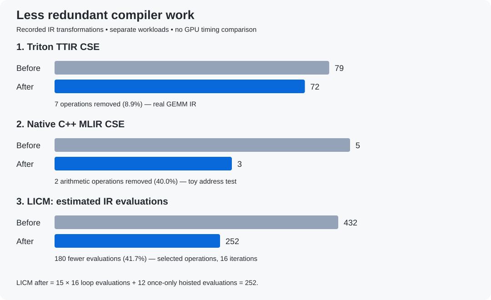

The three charts use separate scales because they measure different workloads. Their percentages must not be added together or interpreted as end-to-end speedups.

### How CSE Improves the IR

CSE replaces repeated expressions with an existing SSA result. In the real TTIR, six dimension expansions and one range construction disappear, lowering the matched operation count from 79 to 72. The Python prototype reproduces these removals and passes its structural checks.

The native C++ pass applies the same reuse principle to integer arithmetic. In the small `gemm_address` case, removing a duplicate multiplication also makes two additions equivalent; both duplicates are eliminated, leaving three arithmetic operations instead of five. Five regression cases pass expected-removal checks and MLIR verification.

```text
Before: p0 = row * stride; p1 = row * stride
        a0 = p0 + col;     a1 = p1 + col
        result = a0 + a1
After:  p0 = row * stride
        a0 = p0 + col
        result = a0 + a0
```

This eliminates redundant IR computation. Its GPU benefit still depends on subsequent lowering, existing backend simplifications, and the workload's bottleneck.

### How LICM Reduces Repeated Work

LICM moves computations independent of the K-loop index before the loop. Their values are reused across all 16 iterations. Unlike CSE, this transformation need not reduce the total static operation count: it changes how often an operation would be evaluated.

| Selected operation | Inside loop before | Inside loop after | Hoisted once | Estimated evaluations before | Estimated evaluations after | Avoided |
|---|---:|---:|---:|---:|---:|---:|
| `tt.expand_dims` | 4 | 2 | 2 | 64 | 34 | 30 |
| `tt.splat` | 4 | 2 | 2 | 64 | 34 | 30 |
| `tt.broadcast` | 8 | 4 | 4 | 128 | 68 | 60 |
| `tt.addptr` | 4 | 3 | 1 | 64 | 49 | 15 |
| `arith.muli` | 3 | 2 | 1 | 48 | 33 | 15 |
| `arith.cmpi` | 4 | 2 | 2 | 64 | 34 | 30 |
| Total | 27 | 15 | 12 | 432 | 252 | 180 |

The estimate counts each selected in-loop operation once per iteration and each hoisted operation once per program instance:

```text
Before = 27 × 16                    = 432 evaluations
After  = 15 × 16 + 12                = 252 evaluations
Saved  = 12 × (16 − 1)               = 180 evaluations
Reduction = (432 − 252) / 432 × 100   = 41.7%
```

The 44.4% reduction in selected operations inside the loop differs from the 41.7% reduction in their estimated evaluations because the hoisted operations still execute once. Neither percentage measures all kernel instructions or runtime latency.

### How LSR Changes Address Generation

In the isolated LLVM example, LSR replaces repeatedly forming `base + k × 64 bytes` with a loop-carried pointer advanced by 64 bytes. This changes the recurrence used to generate addresses; it does not remove the need to update the pointer.

| Validation | Recorded outcome | What it establishes |
|---|---|---|
| Default target, with or without `indvars` | Original shift retained; no pointer PHI | Requested pass execution alone did not produce the desired rewrite |
| Explicit x86-64 target, with or without `indvars` | Original shift removed; pointer PHI introduced | Target-sensitive address rewrite in this example |
| Original and optimized shared libraries | Both exactly match `A[::32]` | Recorded fixed-loop test preserves copied values |
| Real Triton PTX inspection | 64-byte and 32,768-byte pointer increments observed | Backend address recurrences are already present; no controlled GPU before/after comparison |

### Performance Scope and Next Measurements

No GPU latency, throughput, occupancy, or speedup comparison was recorded for these transformations. The native plugin is tested on small standard-dialect arithmetic programs and has not been integrated into Triton GEMM compilation. The x86-64 LSR experiment is also separate from the original GPU kernel.

To establish runtime improvement, the next step is a controlled baseline/optimized GPU comparison with identical shapes, precision, tiles, hardware, and toolchain. It should record correctness, steady-state kernel latency after warm-up, throughput, registers, shared memory, occupancy, and profiler instruction/memory metrics. That comparison would show whether reduced IR work survives lowering and improves the actual bottleneck.


**Technologies:** Triton, MLIR, LLVM, Python, C++, GEMM, TTIR, TTGIR, PTX, SSA, CSE, LICM, and Loop Strength Reduction.

[Back to Home](../index.md)
